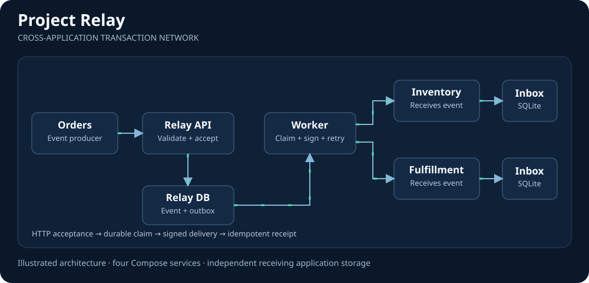
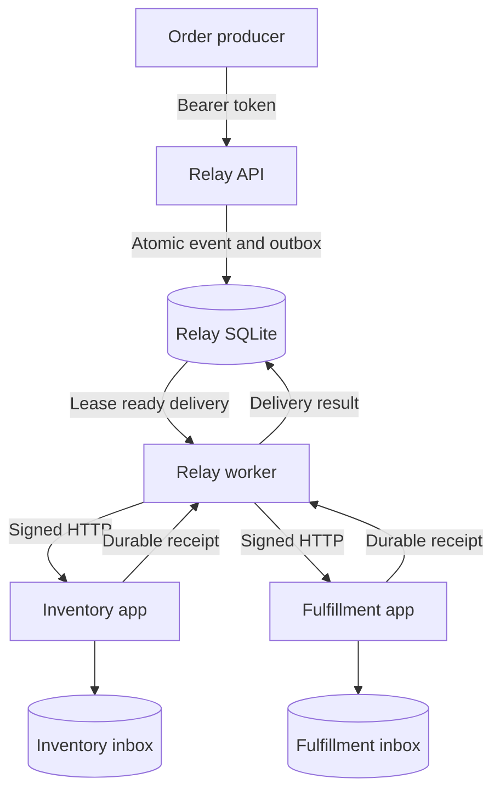
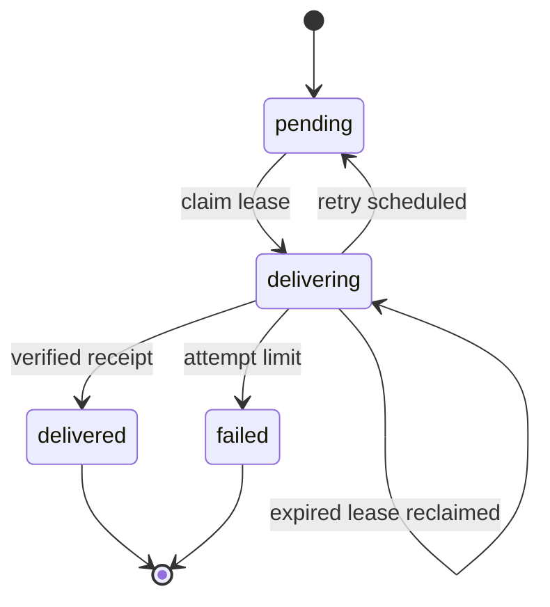

# Project Relay — Cross-Application Transaction Network

A small event-driven microservices project that distributes an accepted business transaction to independent applications. An order producer submits an event to the relay API. A persistent outbox tracks a delivery for Inventory and Fulfillment. Each receiving app stores its own durable, idempotent receipt.

Project Relay is a local reference implementation for cross-application event delivery. It records order events and acknowledgments. It has no real payment processing, inventory decrement or shipment execution.



## Architecture



| Service | Responsibility | State |
|---|---|---|
| Relay API | Validate and authenticate events, accept them atomically, expose delivery status | Relay database |
| Relay worker | Claim events using leases, sign deliveries, retry transient failures, record results | Relay database (same relay boundary) |
| Inventory | Independently receive and deduplicate transaction events | Private inventory inbox |
| Fulfillment | Independently receive and deduplicate transaction events | Private fulfillment inbox |

The relay API and worker run as separate processes and share one durable relay volume. Each receiving application has a separate volume and signing key. Container-to-container communication uses the Compose service network. The public-facing API port is bound to loopback.

## Start locally

Requirements: Docker with Compose v2 and Python 3.12 (standard library only).

From this project directory:

```sh
python -m relay.init_env
docker compose up -d --build
```

The initializer writes a private `.env` with three distinct random secrets and preserves an existing file. To use the launchers, run `./run.sh init` then `./run.sh up`, or in PowerShell run `./run.ps1 -Action Init` and `./run.ps1 -Action Up`.

The ingress API is available at `http://127.0.0.1:8090`. The consumers are internal to Compose. Stop the stack with `docker compose down` (named volumes remain).

### Submit a transaction

In a shell, from this project directory:

```sh
set -a
. ./.env
set +a
curl -sS http://127.0.0.1:8090/transactions \
  -H "Authorization: Bearer $RELAY_TOKEN" \
  -H "Content-Type: application/json" \
  --data '{"transaction_id":"tx-001","source":"orders","type":"order.submitted","payload":{"order_id":"ord-001","sku":"sku-001","quantity":2}}'
```

A successful initial submission returns HTTP 202 and identifies the accepted transaction. Check its per-application delivery status:

```sh
curl -sS http://127.0.0.1:8090/transactions/tx-001 \
  -H "Authorization: Bearer $RELAY_TOKEN"
```

The response lists the destination, state, attempt count and last delivery error for each receiving application. Repeating the same transaction ID and body returns HTTP 200 without creating extra delivery records. Reusing the ID with a different body returns HTTP 409.

## Delivery lifecycle



The API commits the event and its two delivery rows together before responding. The worker claims a row with a 30-second lease and unique token. HTTP failures schedule exponential backoff up to 60 seconds. At six attempts, a delivery becomes failed and remains visible through the status API. An expired lease can be reclaimed, and a stale worker cannot overwrite the newer claim.

Receivers verify an HMAC-SHA256 signature over the original body. Each stores at most one receipt per transaction ID. This gives at-least-once delivery attempts with idempotent receiver processing, including the case where a consumer stored an event but its acknowledgment was lost. The design does not provide a single atomic commit across all applications.

## API contract

| Method and path | Auth | Purpose |
|---|---|---|
| `GET /healthz` | None | Check local datastore |
| `POST /transactions` | Bearer token | Validate and accept an order event |
| `GET /transactions/{id}` | Bearer token | Inspect delivery state |
| Internal `POST /inbox` | HMAC signature | Accept or deduplicate a signed event |

Only the `orders / order.submitted` event contract is accepted for this first implementation. IDs and SKUs are short identifiers, and quantity is a positive bounded integer. Destination names are predefined by the worker.

## Project files

| Path | Purpose |
|---|---|
| `relay/api.py` | Ingress HTTP service |
| `relay/worker.py` | Persistent relay dispatcher |
| `relay/consumer.py` | Application-owned receipt service |
| `relay/store.py` | Transactional outbox, leases and inbox storage |
| `relay/model.py` | Shared event contract |
| `Dockerfile`, `compose.yaml` | Four independently launched service containers |
| `.env.example`, `relay/init_env.py` | Local credential setup |
| `run.sh`, `run.ps1` | Project-specific launchers |
| `tests/` | Regression and loopback integration tests |

## Verification and scope

```sh
python -m unittest discover -s tests -v
```

Six tests verify event validation, atomic submission, idempotency conflicts, lease fencing, durable retry limits, end-to-end HTTP delivery to both apps, and recovery when a receipt is lost. The tests use temporary local databases and ephemeral loopback HTTP servers. Docker Compose has been prepared for future execution. The container stack has not been started in this workspace.

The project uses a single producer credential and stores local data with SQLite. A hosted multi-tenant deployment would require tenant isolation, TLS for all service links, independent authentication, credential rotation, service metrics and durable replicated storage.
