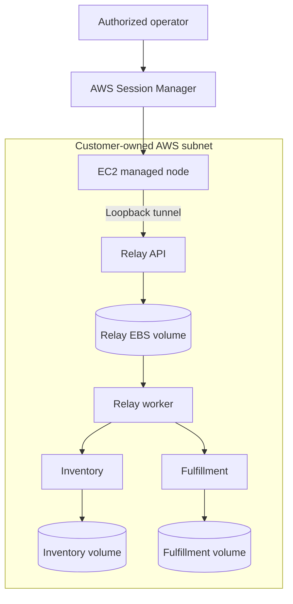

# Project Relay on AWS

This optional deployment profile runs the existing four Docker Compose services on one Ubuntu 24.04 LTS EC2 instance. It uses an encrypted gp3 EBS root disk for the relay and receiving application volumes. A single host is intentional because the API and worker share the SQLite outbox.

The configuration is prepared for users with their own AWS account. No infrastructure was created, and no cloud deployment or runtime verification was performed when preparing these files. EC2, EBS, public IPv4 and data transfer may incur charges when a user deploys the template.

## Cloud architecture



CloudFormation creates the EC2 instance, security group, IAM role and instance profile. The template accepts an existing VPC and public subnet. The subnet must have a route to an internet gateway and working DNS. The instance has a public IPv4 address for outbound package downloads and Systems Manager connectivity. The security group permits outbound HTTP/HTTPS and has no inbound rules. All application ports remain internal to the host or Docker network.

## Prerequisites

- AWS CLI v2 configured with your own authorized identity (SSO or named profile recommended).
- Session Manager plugin for port forwarding and shell sessions.
- Python 3.11+ and Git if resolving the current checkout's revision.
- An existing VPC and public subnet in your chosen Region.
- Permission to create CloudFormation stacks, EC2 resources, instance roles/profiles, pass the scoped role and use Systems Manager sessions.
- A full public GitHub commit SHA containing this project, including the AWS profile files.

The script uses the AWS CLI credential chain. The repository contains placeholder parameters and no cloud credentials.

## Deploy when ready

Clone the repository and change into the project directory:

```sh
git clone https://github.com/ABHILASH9519/Mircoservices.git
cd "Mircoservices/Project Relay — Cross-Application Transaction Network"
```

Replace the VPC/subnet placeholders with your own identifiers and choose the appropriate region. First, inspect the template and optionally request account-side validation:

```sh
python deploy/aws/manage.py --region ap-south-1 validate
```

Create the stack only when you want to incur the corresponding AWS resource usage:

```sh
python deploy/aws/manage.py --region ap-south-1 --stack project-relay deploy --vpc-id vpc-REPLACE --subnet-id subnet-REPLACE
```

This creates a **new** stack and waits for CloudFormation stack creation. The script resolves the checked-out commit by default. To deploy a different published source revision, add `--revision FULL_COMMIT_SHA`. Choose `--instance-type t3.small` if required and available in your Region. Add `--profile YOUR_PROFILE` before the action to select an existing AWS CLI profile.

The same template can be deployed via the CloudFormation console with a filled copy of [parameters.example.json](parameters.example.json). The template uses the public Canonical SSM AMI parameter and enables IMDSv2, encrypted root storage and standard burstable CPU credits.

### Build on the host

At first boot, cloud-init:

1. Installs Docker Engine and the Compose plugin from Docker's official Ubuntu package repository.
2. Ensures the SSM agent is installed and running.
3. Downloads the specified GitHub revision and copies only Project Relay into `/opt/project-relay`.
4. Runs [start-host.sh](start-host.sh), generates private per-deployment credentials if missing, builds the existing Dockerfile and starts all four services with the [AWS Compose overlay](compose.aws.yaml).
5. Waits for running/healthy Compose services and checks the relay API.

The deployment script builds the image on the EC2 instance. A prebuilt image or registry account is unnecessary. CloudFormation completion alone confirms infrastructure creation. Application bootstrapping can still be in progress.

## Verify and connect

Inspect the stack and open a Session Manager shell:

```sh
python deploy/aws/manage.py --region ap-south-1 status
python deploy/aws/manage.py --region ap-south-1 shell
```

Once connected, inspect initialization and service state:

```sh
sudo cloud-init status --wait
sudo tail -n 80 /var/log/cloud-init-output.log
sudo bash -c 'cd /opt/project-relay && docker compose -f compose.yaml -f deploy/aws/compose.aws.yaml ps'
curl -fsS http://127.0.0.1:8090/healthz
```

To make authenticated requests from an operator machine, open another terminal and forward only the relay API port:

```sh
python deploy/aws/manage.py --region ap-south-1 tunnel --local-port 8090
```

The API will be reachable at `http://127.0.0.1:8090` while the session is active. Obtain the generated relay token via the private SSM shell using `sudo grep '^RELAY_TOKEN=' /opt/project-relay/.env` and use it only in the client environment. Keep it out of screenshots, source control and public logs. Use the [project's transaction request examples](../../README.md#submit-a-transaction) to submit synthetic data. Repeated transaction IDs retain their existing semantics.

## Operate and remove

All three named Docker volumes reside on encrypted EBS. Service and instance restarts preserve them. The cloud override restarts the four containers unless explicitly stopped and bounds Docker JSON log files. There is no automatic replication or backup.

For a retry after a bootstrap problem, diagnose the cloud-init logs. If the source is already installed, run:

```sh
sudo bash /opt/project-relay/deploy/aws/start-host.sh
```

This is a first-install template. Editing the CloudFormation user data does not automatically run a new release on an existing instance. For a future deployment use a reviewed upgrade or a new stack from the desired published revision. The script deliberately uses create-stack so an existing stack is not silently replaced.

Back up any needed SQLite data and secrets before teardown. The EBS root volume is deleted when the instance terminates. To remove the stack and its data:

```sh
python deploy/aws/manage.py --region ap-south-1 delete
```

This destroys the stack's instance, root volume and app state, group and role. The customer-provided VPC and subnet remain. Verify the stack deletion completes and review any additional resources created separately in your account.

## References

- [Canonical Ubuntu AWS AMI parameters](https://documentation.ubuntu.com/aws/aws-how-to/instances/build-cloudformation-templates/)
- [Docker Engine on Ubuntu](https://docs.docker.com/engine/install/ubuntu/)
- [AWS Session Manager port forwarding](https://docs.aws.amazon.com/systems-manager/latest/userguide/session-manager-working-with-sessions-start.html)
- [AWS EC2 user data lifecycle](https://docs.aws.amazon.com/AWSEC2/latest/UserGuide/user-data.html)
